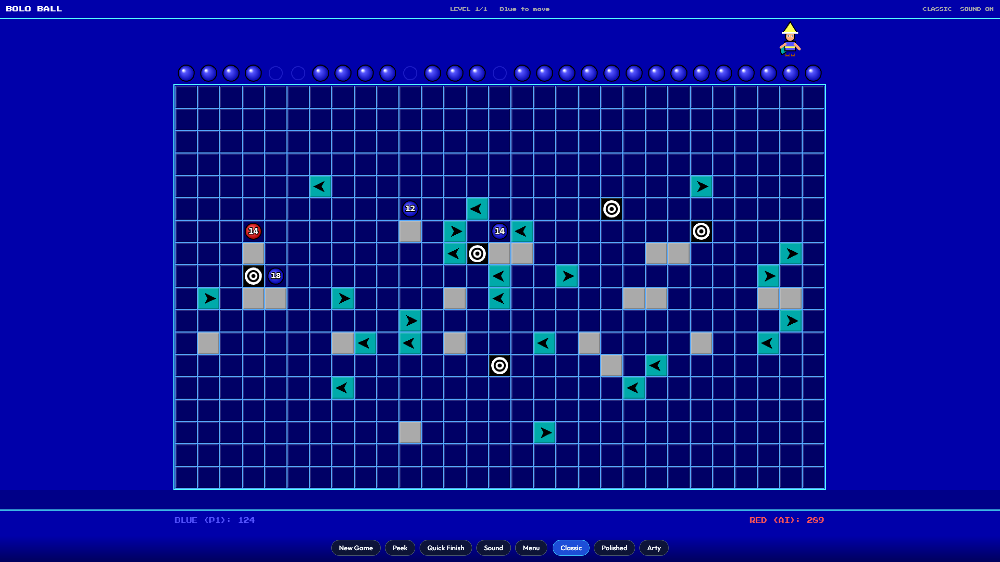

# Bolo Ball

A browser remake of the classic **Bolo Ball** puzzle game (Soleau Software). Push marbles down a maze of arrows, gray shelves, bonuses, and black holes. Race your opponent (or the AI) for the highest score.

Built with **TypeScript** and **Vite**. No framework — canvas rendering and a small DOM shell for menus and HUD.



## Play

```bash
npm install
npm run dev
```

Open the URL Vite prints (usually `http://localhost:5173`).

| Script | What it does |
|--------|----------------|
| `npm run dev` | Local dev server with hot reload |
| `npm run build` | Typecheck + production build into `dist/` |
| `npm run preview` | Serve the production build |

## How to play

Each player has one marble per column. On your turn, move the pusher along the top row and drop a marble into a free column. The marble falls, slides on arrows, collects bonuses, and may teleport through black holes. Deeper landings and bottom exits score more.

When both players have used every marble, gray shelves vanish and remaining balls fall again. This cascade earns no points: a ball's score is final once it first stops. Multi-level games carry leftover balls into the next board as bonus tiles.

Full rules and scoring: [docs/GAMEPLAY.md](docs/GAMEPLAY.md).

### Controls

#### Phone / touch

The game is made for phones held **upright (portrait)**. The board fills the screen width with the controls below it.

| Touch | Action |
|-------|--------|
| Tap a ball (or anywhere in its column) | Walk the pusher to that column |
| Tap the column the pusher is on | Drop, so a new ball takes two taps and the current one takes one |
| Drag across the board | Aim live; lifting your finger does not drop |
| `◀` / `▶` buttons | Move pusher one column |
| `DROP` button | Drop marble |
| `Zoom on` / `Zoom off` button | Turn the drop zoom on or off |
| `×` on the zoom window | Close the zoom for this drop only |

**Drop zoom:** on phones, a magnified window pops up over the controls while a ball falls. It follows the ball and fades out about 0.7s after the ball lands. It is on by default, the on/off choice is remembered on the device, and it stays hidden during Quick Finish.

If the phone is turned sideways, a "turn your phone upright" notice covers the game. Normal web pages can't block rotation; Android can hold portrait when the game is opened fullscreen or added to the home screen.

#### Keyboard / mouse

| Input | Action |
|-------|--------|
| `←` / `→` | Move pusher |
| `↓` / `Space` | Push / drop marble |
| Click column | Select column (click it again to drop) |
| `L` | Peek at opponent’s remaining marbles |
| `T` | Cycle theme (Classic / Polished / Arty) |
| `S` | Toggle sound |
| `N` | New game |
| `Esc` | Back to menu |

HUD buttons mirror peek, sound, new game, menu, and **Quick Finish** (auto-plays the rest of the level with faster animation). On phones the theme buttons are hidden during play; choose a theme in the start menu.

### Game options

- **1 Player vs AI** or **2 Players (hot-seat)**
- Length: **Short** (1 level), **Long** (3), **Extended** (5)
- AI: Easy / Normal / Hard
- Themes: Classic, Polished, Arty (switchable mid-game)

## Hosting (GitHub Pages)

The built game in `dist/` is committed, and its paths are relative (`base: './'` in `vite.config.ts`), so it works from a sub-folder such as `https://<user>.github.io/BoloBall/`. After changing code, run `npm run build` and commit `dist/` with it.

**Updates show up without clearing history.** GitHub Pages lets browsers cache `index.html` for a while, which used to keep the old game loading after a push. Each build now writes its id to `dist/version.json` and bakes the same id into the game. When the page opens, or the tab comes back into view, the game compares the two. If a newer build is deployed, it reloads once onto it, but only on the menu or results screen, never mid-game.

The page is kept out of search engines with a `noindex` meta tag; `robots.txt` is also included but only applies at a domain root.

## Project layout

```
src/
  main.ts           Game loop, UI wiring
  game/             Rules, board, physics, AI, match state
  render/           Canvas renderer + themes
  ui/               Menu, results, sound
  styles/           App CSS
public/             Favicon, robots.txt, web app manifest
dist/               Built game (committed, served by GitHub Pages)
docs/               Gameplay rules and architecture notes
```

Contributor-oriented overview: [docs/ARCHITECTURE.md](docs/ARCHITECTURE.md).

## License

Private project (`package.json` `"private": true`). Add a license here if you publish or share the repo.
